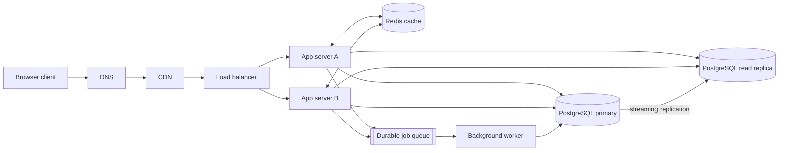

# QuickNotes architecture

## Requirements

### Functional requirements

- Users can register, sign in, and sign out securely.
- Authenticated users can create, view, edit, and delete their own notes.
- Users can search and paginate through notes.
- Users can create tags and attach multiple tags to notes.
- Users can access the service from a responsive browser client.
- The API returns consistent JSON responses and useful validation errors.

### Non-functional requirements

- **Availability:** Target 99.9% monthly availability for the API.
- **Performance:** 95% of reads should complete within 300 ms and 99% within
  800 ms under normal load.
- **Scalability:** Application servers must scale horizontally without storing
  user session state locally.
- **Durability:** Committed notes must survive an application or single-node
  database failure, with automated backups and point-in-time recovery.
- **Security:** Encrypt traffic with TLS, hash passwords with a modern password
  hashing algorithm, enforce authorization, and protect secrets outside source
  control.
- **Privacy:** A user must never be able to read or modify another user's
  notes.
- **Observability:** Centralize logs, metrics, traces, and alerts for latency,
  errors, queue depth, and database health.
- **Maintainability:** Version the API, use automated tests and migrations, and
  deploy through a repeatable CI/CD process.

## Capacity estimate for 1 million users

These are planning estimates rather than measured production traffic. Assume
1,000,000 registered users, 20% daily active users, and each active user
opening the notes screen 10 times and creating two notes per day.

| Metric | Assumption and calculation | Planning capacity |
| --- | --- | --- |
| Daily active users | `1,000,000 x 20%` | 200,000 |
| Note reads per day | `200,000 x 10` | 2,000,000 |
| Note writes per day | `200,000 x 2` | 400,000 |
| Average reads per second | `2,000,000 / 86,400` | 23 reads/s |
| Average writes per second | `400,000 / 86,400` | 5 writes/s |
| Peak reads per second | 10x average for daily peaks | 230 reads/s |
| Peak writes per second | 10x average for daily peaks | 50 writes/s |
| Stored notes after one year | `400,000 x 365` | 146 million notes |
| Note data storage per year | About 2 KB per note including indexes and metadata | About 292 GB |
| Total provisioned database storage | Data plus indexes, WAL, replicas, and headroom | Start at 1 TB |

The service should provision for at least the peak figures, with autoscaling
headroom for unexpected traffic. Attachments are out of scope for this estimate;
if they are added, they should use object storage rather than database rows.

## High-level architecture

### Component responsibilities

- **Browser client:** Provides the user interface and sends authenticated API
  requests without owning authoritative data.
- **DNS:** Resolves the public QuickNotes hostname and supports health-aware
  routing during infrastructure changes.
- **CDN:** Caches static HTML, CSS, JavaScript, and other public assets close to
  users, reducing origin bandwidth and latency.
- **Load balancer:** Terminates or forwards TLS, performs health checks, and
  distributes API traffic across healthy app servers.
- **App servers:** Validate requests, enforce authorization, run business logic,
  and remain stateless so more instances can be added.
- **Redis cache:** Reduces repeated database reads for safe, short-lived data
  such as note-list results and rate-limit counters.
- **PostgreSQL primary:** Is the source of truth for transactional writes,
  constraints, users, notes, tags, and relationships.
- **PostgreSQL read replica:** Serves eligible read-only queries and reduces
  contention on the primary.
- **Durable job queue:** Buffers asynchronous work and allows requests to finish
  without waiting for email, indexing, or notification jobs.
- **Background worker:** Consumes queued jobs with retries and records failures
  in a dead-letter queue for investigation.

## Request flows

### `GET /api/v1/notes`

1. The browser resolves `api.quicknotes.example` through DNS and sends the
   request over HTTPS.
2. The CDN serves a cached static client when applicable; the API request
   continues through the load balancer.
3. The load balancer health-checks and selects one healthy app server.
4. The app server validates the access token, parses pagination and search
   parameters, and applies the authenticated user's authorization scope.
5. The app server checks Redis for a short-lived key containing the user's
   exact query and pagination parameters.
6. On a cache hit, the server returns the cached JSON response.
7. On a miss, the server queries the read replica, stores the safe response in
   Redis with a short TTL, and returns it to the browser.
8. Note mutations invalidate affected cache keys so a later read does not serve
   stale data beyond the intended TTL.

### `POST /api/v1/notes`

1. The browser sends the JSON title and optional body over HTTPS with its access
   token.
2. DNS, the load balancer, and health checks route the request to an app server.
3. The app server validates the payload, authenticates the user, and authorizes
   the operation.
4. The app server starts a transaction on the PostgreSQL primary and inserts
   the note; database constraints enforce ownership and field limits.
5. The transaction commits before the API returns `201 Created` with the new
   note and its server-generated ID.
6. The app server invalidates the user's affected note-list cache keys.
7. Non-critical follow-up work, such as search indexing or an activity event,
   is placed on the durable queue for the worker to process asynchronously.
8. The browser adds the returned note to its local view and does not assume
   that a queue job has completed before displaying the successful write.

## Trade-offs and failure handling

### Strong writes versus read scaling

All writes go to the primary, while list reads can use the replica. This keeps
transactions and constraints simple but introduces replication lag: a read
immediately after a write may temporarily miss the new note. The API can route
read-after-write requests to the primary for a short consistency window. The
primary is protected with synchronous or monitored replication, automated
backups, and a tested failover process; the replica can be promoted if the
primary fails.

### Cache freshness versus database load

Redis improves latency and reduces database load, but cached lists can become
stale and Redis itself is another system to operate. Short TTLs plus explicit
invalidation after note mutations limit staleness. Redis should run as a
managed highly available cluster with replicas; if it is unavailable, the app
falls back to PostgreSQL rather than treating the cache as the source of truth.

### Synchronous work versus queue latency

Sending indexing, email, and analytics jobs to a queue keeps note creation fast,
but those side effects are eventually consistent and require retry handling.
The queue uses replicated durable storage, workers run in multiple instances,
and failed jobs go to a dead-letter queue. Creating the note itself remains
synchronous and is not considered successful until the primary commits it.

### Simplicity versus multi-region deployment

A single write region is easier to reason about and avoids cross-region write
conflicts, but users far from that region see higher write latency. The CDN,
stateless app servers, read replicas, backups, and DNS failover improve
availability without introducing multi-master consistency complexity. A second
region can be added later as a disaster-recovery or read-only region.

## Single-point-of-failure avoidance

There is no intentional single instance for the web tier: the load balancer
routes across at least two app servers, and failed instances are removed by
health checks. DNS and CDN providers should use managed redundant service.
Redis uses replication and automatic failover, and the queue uses replicated
durable storage. PostgreSQL has a streaming read replica, automated backups,
point-in-time recovery, and a documented promotion procedure. Monitoring
alerts on replica lag, queue depth, cache health, and failed health checks so
operators can respond before a partial failure becomes an outage.
